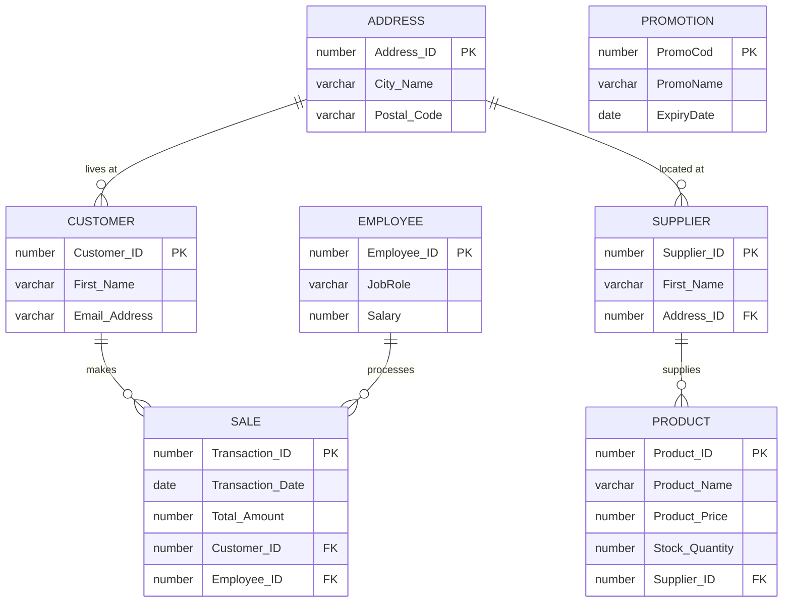

# Clothing Retail Store DBMS

An Oracle database for a clothing retail store: inventory, suppliers, customers, sales,
employees and promotions, with SQL views for reporting and an Oracle APEX front end.

Built by a 3-person team for CPS510 (Database Systems) at Toronto Metropolitan University, Fall 2024.

## What's inside

| Folder | Contents |
| --- | --- |
| `Database/schema.sql` | 7 tables with primary keys, foreign keys, `NOT NULL`, `UNIQUE` and `CHECK` constraints |
| `Database/seed_data.sql` | Sample data |
| `Database/views_and_queries.sql` | Reporting views (customer spend, supplier stock, employee sales) and analysis queries |
| `APEX/application_export.sql` | Oracle APEX app for managing the data through forms and reports |
| `Documentation/` | Final report (ER model, normalization to 3NF/BCNF, relational algebra, UNIX shell menu) and user manual |

## ER diagram



## Example views and queries

- **CustomerOrdersView**: transactions and total spent per customer
- **SupplierProductView**: product count and total stock per supplier and category
- **EmployeeSalesPerformanceView**: transactions handled and sales total per employee
- Average price per product category, products with no supplier, suppliers covering multiple categories

## Run it

In Oracle (SQL*Plus, SQL Developer or APEX SQL Workshop), run in this order:

```sql
@Database/schema.sql
@Database/seed_data.sql
@Database/views_and_queries.sql
```

To use the APEX app, import `APEX/application_export.sql` in **App Builder → Import**.

## Tech

Oracle Database · SQL · PL/SQL views · Oracle APEX · UNIX shell
